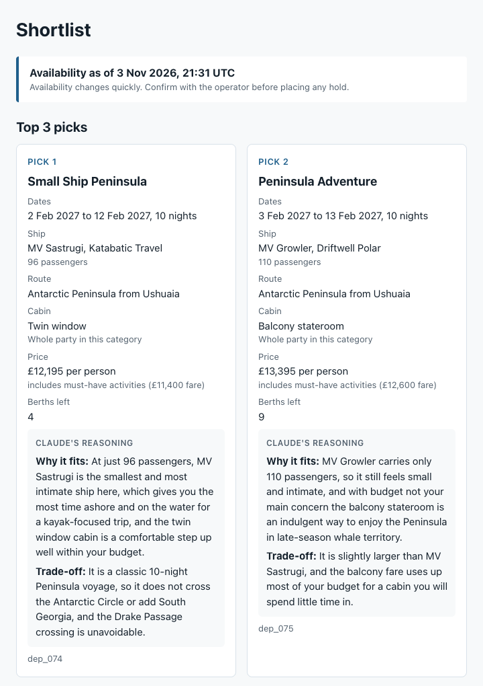
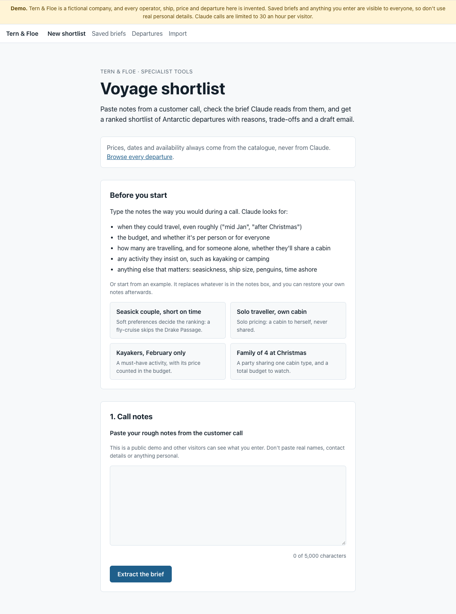
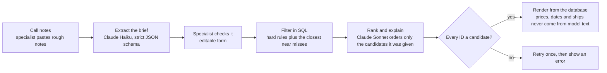

# Voyage shortlist

An internal tool for **Tern & Floe**, a polar travel specialist that sells Antarctic expedition voyages from every operator. A specialist pastes rough notes from a customer call and gets a ranked shortlist of departures, with a reason and a trade-off for each, a comparison table and a draft email.

The core principle: **SQL decides what's possible, Claude decides what fits.** The database applies the yes-or-no rules (dates, budget, berths, solo cabins, activity places). Claude only orders the departures the database returned and explains why. Every price, date, ship name and availability figure on screen and in the email comes from the database, never from model text.

> **Everything here is invented.** Tern & Floe is a fictional company, and every operator, ship, voyage, price and departure is made up. This is a portfolio proof of concept, not a product for a real client.

**Live demo:** https://voyage-shortlist-gffgokpk6a-nw.a.run.app (public, so anything you enter is visible to every visitor: don't use real personal details)



[See the whole page](docs/shortlist.png), from the call notes through the checked brief, all three picks, the comparison table, near misses and the draft email.

**Stack:**

- Next.js 16 (App Router, server actions), React 19, TypeScript
- The Anthropic SDK, with Claude Haiku 5.5 and Claude Sonnet 5.5
- Postgres: Neon in production, PGlite locally and in tests
- Zod at every boundary, Vitest
- GCP: Cloud Run, Cloud Build, Cloud Scheduler, Cloud Storage, Secret Manager

## Using it



The nav has four pages: **New shortlist**, **Saved briefs**, **Departures** and **Import**.

### Build a shortlist

1. **Paste the call notes** on **New shortlist**, or pick one of the example notes above the box to see how it works. Write them the way a specialist would jot them down during a call, for example: _"Couple, late Jan or Feb, up to £9k each, she gets seasick, really want penguins and maybe kayaking."_
2. **Choose Extract the brief.** Claude reads the notes into a form: date window, budget per person, party size, solo preference, must-have activities and softer preferences. Anything the notes leave unclear is listed for you to check.
3. **Check and correct the form.** This is the specialist's review step, so a misread budget or date is caught before any search runs.
4. **Choose Build the shortlist.** You get:
   - the **top 3 departures**, each with its cabin, price, dates, one reason and one trade-off
   - a **comparison table** of the picks
   - **near misses**, each labelled with the rule it breaks (for example "£800 over budget" or "departs 3 days outside the window")
   - a **draft email** in your name, ready to edit and copy. The tool sends nothing.
   - **"Availability as of"**, so you know how old the berth counts are. Confirm with the operator before any hold.
5. **Choose Save brief** if the customer is still deciding.

When nothing fits and there are no near misses, the shortlist says which rule excluded the most departures, so you know what to change.

### Saved briefs and new matches

**Saved briefs** lists every saved brief. Each night a job checks saved briefs against the current catalogue and lists any new departure that fits under **New matches**, with the time it last checked.

A saved shortlist is a record of what was sent, so new matches never rewrite it. On a brief's page, **Rebuild with current availability** runs the search and ranking again and writes a fresh email. The earlier shortlist stays in the log.

### Departures

**Departures** lists the whole catalogue: every departure with its dates, voyage, ship, lowest price per person, berths left and activities, and when its availability was last updated. Departures that have already sailed are left out.

### Import availability

Operators send availability updates as a CSV file. **Import** explains the format and has a sample file to download. Uploading a file needs the demo admin token, so visitors can see how it works but can't change the catalogue. An import is all or nothing: one bad row rejects the whole file, and every error is reported with its spreadsheet row number. Sample files are in [`samples/`](samples/).

### Limits on the public demo

- 30 Claude calls per visitor per hour, and 200 per hour across the whole app. One shortlist is 2 calls: one to extract and one to rank.
- At most 2 Cloud Run instances, a monthly spend limit on the Anthropic key and a GCP budget alert.
- The catalogue is reseeded every Sunday, and its season rolls forward each year so the dates stay current.

## How it works



There are only two Claude calls, and each is a single Messages API call with a strict output schema: no agent loop and no tools.

- **Extract the brief** (`src/claude/extract.ts`): notes in, structured brief out.
- **Rank and explain** (`src/claude/rank.ts`): the confirmed brief plus the SQL candidates and near misses in, an ordered list of departure IDs with reasons and trade-offs out. The email draft uses placeholders such as `{{departure:ID.price}}`, which the server fills from the database (`src/claude/placeholders.ts`).

The search is two SQL queries in `src/db/search.ts`: a hard filter and a near-miss query that expresses the same rules as distances.

## Key decisions

The full list, with the reasoning behind each, is in [`DECISIONS.md`](DECISIONS.md), and the domain terms are in [`GLOSSARY.md`](GLOSSARY.md).

| Question | Decision |
| --- | --- |
| How is it impartial? | The schema has no commission or margin fields, so the ranking can't favour a better-paying operator. Every pick shows a reason and a trade-off. |
| Which models? | Claude Haiku 5.5 to extract (cheap, simple task) and Claude Sonnet 5.5 to rank (where the quality shows), both overridable by environment variable. |
| How fresh is availability? | Every departure stores when its availability was last updated, and the shortlist shows "availability as of". |
| Where does the data come from? | A deterministic seed: 6 invented operators, 14 ships and 83 departures, with deliberate edge cases such as a sold-out favourite and a large ship that can't land. CSV imports stand in for operator feeds. |

## Architecture on GCP

Everything runs in project `tern-floe`, region `europe-west2` (London).

| Piece | Service | Why |
| --- | --- | --- |
| Web app | Cloud Run (`voyage-shortlist`), 0 to 2 instances, as `voyage-web` | Scales to zero for a demo, and the instance cap bounds cost. |
| Database | Neon Postgres (free tier, AWS London) | The smallest Cloud SQL instance costs about £8 a month idle. Neon suspends when idle and costs nothing at this size. |
| Migrations | Cloud Run job `voyage-db`, run by every deploy before the new revision | Avoids two instances racing to migrate at startup. A failed migration stops the deploy. |
| Nightly matches | Cloud Run job `voyage-matches`, triggered at 02:00 by Cloud Scheduler | Writes new matches for saved briefs. |
| Weekly reseed | Cloud Run job `voyage-reseed`, Sundays at 03:00 | Resets the catalogue and keeps saved briefs and their matches. |
| CSV uploads | Cloud Storage bucket `tern-floe-imports` | Keeps every raw file next to its import record. |
| Secrets | Secret Manager | The database URLs, the Anthropic key and the admin token. Each is readable only by the account that needs it. |
| Build and deploy | Cloud Build trigger on push to main, images in Artifact Registry | Typecheck, lint, test, build, migrate, deploy. A separate trigger runs checks on every PR with an account that can't deploy. |
| Custom domain (in progress) | Firebase Hosting, forwarding to Cloud Run | Free, with a certificate. Cloud Run's own domain mapping isn't offered in europe-west2. |

Each service account has only the roles it needs. The build account's custom roles can deploy and release, but can't delete the service, its jobs or the Hosting site. [`scripts/gcp-setup.sh`](scripts/gcp-setup.sh) creates all of this and is safe to re-run.

## How a real internal deployment would differ

- **Access:** behind Identity-Aware Proxy with company Google sign-in, instead of a public URL with rate limits. Saved briefs would belong to a specialist, not be visible to everyone.
- **Database:** Cloud SQL for Postgres with IAM database authentication through the Cloud SQL connector, instead of Neon with a password in Secret Manager.
- **Data:** real operator feeds on a schedule, instead of a seeded catalogue and manual CSV uploads.
- **Approval:** a review step before anything reaches a customer, and a record of who approved each email.

## Known limitations

- **The custom domain isn't live yet.** Behind Firebase Hosting, the rate limit reads Firebase's address instead of the visitor's, so it has to be fixed before the domain is switched on.
- **Firebase Hosting cuts requests off at 60 seconds,** while a ranking may take longer. How close real rankings get is still to be measured.
- **Submit buttons drop keyboard focus while they work,** because they disable themselves. They'll all be switched together.

Each is tracked under "Open" in [`DECISIONS.md`](DECISIONS.md).

## Repo layout

```text
src/
├── app/          # pages and server actions
│   ├── brief/        # call notes, example notes and the editable brief form
│   ├── shortlist/    # picks, comparison table, near misses, email draft
│   ├── briefs/       # saved briefs, new matches, rebuild
│   ├── departures/   # the catalogue browser
│   ├── import/       # the CSV format and the sample download
│   └── admin/import/ # CSV upload, behind the admin token
├── claude/       # the two Claude calls, their prompts and placeholder filling
├── db/           # migrations, seed, search queries, import, nightly matches, rate limits
├── domain/       # the brief, shortlist and season types and rules, shared by app and jobs
├── evals/        # the 10 evaluation briefs and the runner
└── lib/          # dates, money, storage and the client address
scripts/gcp-setup.sh   # creates the GCP project's resources, safe to re-run
samples/               # example availability CSVs, one good and one with errors
evals/                 # evaluation notes and saved results
cloudbuild.yaml        # deploy on push to main; cloudbuild-pr.yaml runs checks on PRs
```

## How it was built

- **A branch and PR for every stage.** The build ran in five phases (pipeline, data, the Claude calls, the UI, the data pipeline), each deployed and working before the next began.
- **Two reviews compared before each PR.** One review looks for correctness, security and abuse problems, the other for React, accessibility and maintainability problems. Their findings are compared side by side, and each is fixed or dismissed with a reason before the PR opens.
- **Checks on every PR.** A separate Cloud Build trigger runs typecheck, lint and tests with an account that can't deploy, and `main` only accepts changes through a PR that passes them.
- **Decisions written down as they're made**, in [`DECISIONS.md`](DECISIONS.md), with open questions listed at the end.
- **Evaluation against the real API.** Prompt changes were judged by the evaluation's hit rate and cost, not by eye. The last full run put 10 of 10 expected picks in the top 3 and 9 at number 1.

## Running it locally

Needs Node 24 and pnpm 11.

```sh
pnpm install
pnpm dev
```

`pnpm dev` migrates and seeds a local PGlite database (Postgres compiled to WebAssembly) in `.data/`, so no database server is needed. Open http://localhost:3000.

Browsing departures works without a key. Extracting and ranking need an Anthropic API key. Put it in `.env.local`, which git ignores and Next reads at startup, so the key stays out of your shell history:

```sh
# .env.local
ANTHROPIC_API_KEY=your-key
```

| Variable | Purpose | Default |
| --- | --- | --- |
| `ANTHROPIC_API_KEY` | The two Claude calls | none |
| `DATABASE_URL` | Postgres connection | local PGlite in `.data/` |
| `CLAUDE_EXTRACT_MODEL`, `CLAUDE_RANK_MODEL` | Override the models | `claude-haiku-5-5`, `claude-sonnet-5-5` |
| `DEMO_ADMIN_TOKEN` | Allows CSV uploads | unset, so every upload is refused |
| `IMPORT_BUCKET` | Where uploaded files are stored | unset, so files aren't stored |

### Tests

```sh
pnpm verify   # typecheck, lint and all 268 tests
pnpm test     # tests only
```

The tests run against real Postgres (PGlite in memory) with the Anthropic client mocked, so they need no key or network.

### Evaluation

The evaluation runs outside Next, so it doesn't read `.env.local`. Pass the key from Secret Manager inside the command instead, so it never lands in your shell history:

```sh
ANTHROPIC_API_KEY="$(gcloud secrets versions access latest --secret=anthropic-api-key --project=tern-floe)" pnpm eval
```

Runs both Claude calls over 10 invented briefs, each with the departure a specialist would expect first, and reports how many land in the top 3 and at number 1, plus the cost. It calls the real API: the last full run cost £0.16, and a run with retries can cost up to about £0.60. Details and the pass bar are in [`evals/README.md`](evals/README.md).

### Database commands

```sh
pnpm db:migrate   # apply pending migrations
pnpm db:seed      # reset the catalogue to the seeded data
```
