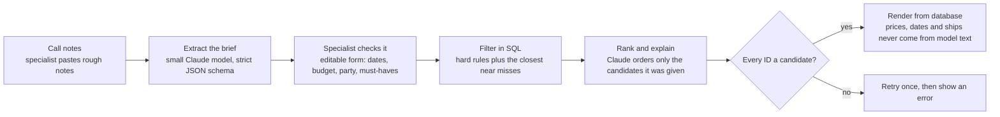

# Plan: Voyage shortlist builder

## Context

This is a proof of concept for a portfolio: a working internal tool, built for an invented company, that I can point to and say "I've built this". It is not for a real client, so there is nobody to ask. Every product question has already been answered in this plan. Where something isn't covered, raise it as a question as we go and offer choices so we can collaboratively make a sensible decision, then write it down in `DECISIONS.md` and carry on.

The fictional company is **Tern & Floe**, a polar travel specialist that sells Antarctic expedition voyages from every operator and promises impartial advice. All company, operator and ship names, prices and data are invented. No real company's name or branding should appear anywhere.

The tool helps a Tern & Floe specialist turn rough notes from a customer call into a ranked shortlist of Antarctic departures, with reasons and a draft email. The core principle is that **SQL decides what's possible and Claude decides what fits**. The model never produces a price, date, ship name or availability figure that the user sees.

## Stack (fixed)

- TypeScript, Next.js (current stable, App Router), React
- The Anthropic SDK (`@anthropic-ai/sdk`) used directly. Not the Vercel AI SDK, and no agent or tool loop: each Claude step is a single Messages API call with a strict output schema.
- Postgres on Cloud SQL, through `pg` and the Cloud SQL Node.js Connector with IAM database authentication
- Zod for validating every boundary: form input, CSV rows, model output
- Vitest for tests, with the Anthropic client mocked
- GCP: Cloud Run, Cloud SQL, Secret Manager, Cloud Build, Artifact Registry, Cloud Storage, Cloud Run jobs, Cloud Scheduler. Region `europe-west2` (London) throughout.

Check current documentation rather than relying on memory for the Anthropic SDK, Next.js and GCP specifics, and note anything that differs from this plan in `DECISIONS.md`.

## How a request flows

The two Claude calls are "Extract the brief" and "Rank and explain". Everything else is plain code or SQL.

## Product decisions

| Question | Decision | Why |
| --- | --- | --- |
| Who uses it? | Tern & Floe's specialists only. Customers never see its output directly. | A person checks every shortlist before it goes out. |
| What goes in? | The specialist pastes rough notes from a call. Claude turns them into a structured brief, shown as an editable form before any search runs. | Real input is messy, and a review step catches a misread budget or date. |
| Where does voyage data come from? | A seeded Postgres dataset: 6 invented operators, about 14 ships and about 80 departures for the 2026–27 season, each with cabin categories, prices in GBP per person and berths left. Updates arrive as a CSV upload that stands in for an operator feed. | Realistic enough to rank, small enough to reason about, and the CSV import gives the build a genuine data pipeline. |
| How fresh is it? | Every departure stores when its availability was last updated, and the shortlist says "availability as of". The specialist confirms with the operator before any hold. | Availability goes stale quickly, so the tool is honest about it. |
| What does SQL decide? | The hard rules: date window, price per person within budget for an available cabin, enough berths for the party, a solo option when travelling alone, and any must-have activity with places left. | These are yes-or-no facts, and a database gets them right every time. |
| What does Claude decide? | The soft fit: pace, ship size, seasickness worries, wildlife priorities and comfort. It ranks the candidates SQL returned and explains the order. | This is judgement from language, which is what a model is good at. |
| How is it impartial? | The schema has no commission or margin fields at all. Ranking is on fit only, and every pick shows its reason and one trade-off. | It can't favour a better-paying operator if it never sees what operators pay. |
| What comes out? | The top 3 departures, a comparison table and a draft email in the specialist's voice. The specialist edits it and copies it out. The tool sends nothing. | It saves time without taking the specialist's judgement or name off the email. |
| How do we stop made-up facts? | Claude returns departure IDs and reasons in a strict schema. The server rejects any ID that wasn't a candidate. Prices, dates and ship names on screen and in the email always come from the database, never from model text. | The failure that would really hurt a travel business is a wrong price or date sent to a customer. |
| What if nothing fits? | SQL also returns near misses with the rule each one breaks, such as "£800 over budget" or "departs 3 days outside the window". Claude explains the trade-off. | That's the conversation a good specialist has anyway: here's what it would take. |
| Saved briefs | A specialist can save a brief. A nightly job finds new or changed departures that match and lists them under "New matches". No emails. | Cloud Scheduler doing real work without building an email system. |
| Which models? | A small, cheap Claude model for extraction and a mid-tier one for ranking, chosen by current price at build time and set by environment variable. Output tokens are capped. | Extraction is simple. Ranking is where the quality shows. |
| Who can open the demo? | The live demo is public, with a demo banner, a per-IP rate limit in the app, a cap on Cloud Run instances, a spend limit on the Anthropic key and a GCP budget alert. The README explains that a real internal tool would sit behind Identity-Aware Proxy with company Google sign-in. | Reviewers need to click it without an account, and the README shows how it would be locked down properly. |
| Where does it run? | Cloud Run and Cloud SQL for Postgres in europe-west2, on the smallest Cloud SQL tier. | Cloud SQL is the GCP skill being shown, and both services sit near the users. |
| How does it deploy? | A Cloud Build trigger on every push to main: typecheck, test, build the image into Artifact Registry, deploy to Cloud Run. The Anthropic key lives in Secret Manager. | All platform, nothing hand-built. |
| Out of scope | Real holds and bookings, payments, flights, a customer-facing UI, emails, and the Arctic or Patagonia. | Keeps it to a few focused phases. |

## Domain notes (for the seed data and the prompts)

- **Season:** voyages run roughly November to March. Early season means more snow and ice and penguin courtship, mid-season means chicks, and late season means whales.
- **Routes:** the classic Peninsula trip is the shortest. Longer voyages cross the Antarctic Circle or add the Falklands and South Georgia. Most voyages sail from Ushuaia.
- **Fly-cruises:** passengers fly over the Drake Passage instead of sailing it. This is the obvious answer for anyone worried about seasickness or short of time, and it's a good test of whether the ranking reads soft criteria properly.
- **Ship size:** ships carrying more than 500 passengers may not land at all, no more than 100 people can be ashore together, and only one ship can use a landing site at a time. Smaller ships therefore get more time ashore.
- **Activities:** kayaking, camping and similar options have limited places and are often booked separately.
- **Cabins:** prices vary a lot between categories on one departure. Solo travellers either share or pay a single price.

## Data model (first sketch; refine it, keep the principles)

Price and availability belong to a cabin category on a specific departure, not to the voyage or the ship.

| Table | Key columns | Notes |
| --- | --- | --- |
| operators | id, name | Invented names only. |
| ships | id, operator_id, name, passenger_capacity | Capacity drives the time-ashore reasoning. |
| voyages | id, ship_id, name, route, embark_port, nights | `route` is a fixed set: peninsula, antarctic_circle, falklands_south_georgia, fly_cruise. |
| departures | id, voyage_id, start_date, end_date, availability_updated_at | One row per sailing date. |
| cabin_categories | id, ship_id, name, sleeps, description | For example a triple, a twin with window or a suite. |
| departure_fares | departure_id, cabin_category_id, price_gbp_pp, solo_price_gbp, berths_left | Price and availability live here. No commission or margin column, on purpose. |
| activities, departure_activities | departure_id, activity_id, places_left, price_gbp | Kayaking, camping and so on. |
| briefs | id, raw_notes, criteria (jsonb), saved, created_at | The notes and the structured brief after the specialist has checked it. |
| shortlists | id, brief_id, candidate_ids, result (jsonb), model, input_tokens, output_tokens, created_at | Every run is logged, for checking quality and cost. |
| matches | brief_id, departure_id, found_at, seen | Written by the nightly job. |
| availability_imports | id, storage_uri, rows_changed, status, imported_at | One row per CSV upload. |
| rate_limits | ip, window_start, count | Per-IP limit for the public demo. |

Use plain SQL migrations. Write two queries carefully and test them directly:

1. **Hard filter:** departures in the date window with a fare whose price for the party fits the budget, enough berths, a solo option if needed, and the must-have activity with places left.
2. **Near misses:** the same rules expressed as distances (pounds over budget, days outside the window, berths short), returning the closest few that fail exactly one rule, each labelled with the rule it breaks.

**Seed script:** deterministic, with a fixed random seed, so the data and the evaluation set stay stable between runs. Include deliberate edge cases: a sold-out favourite, a fly-cruise just over budget, and a large, cheap ship that can't land.

## The two Claude calls

Both calls use `output_config.format` with a JSON schema (structured outputs; the older `output_format` parameter is deprecated). Check whether the TypeScript SDK has a Zod-based helper for this and use it if so; otherwise validate the parsed output with Zod.

Design schemas within the structured-outputs limits: no numeric min/max, no string length limits, no recursion, and `additionalProperties: false` everywhere. Structured outputs can't be combined with citations.

1. **Extract the brief** (small model). Input: the raw notes. Output: the criteria the form needs (date window, budget per person, party size and make-up, solo or shared, must-have activities, soft preferences as short phrases, and anything the notes leave unclear). The form shows every field for the specialist to correct.
2. **Rank and explain** (mid-tier model). Input: the confirmed brief, plus the candidates and near misses from SQL as compact structured data with their IDs. Output: an ordered list of departure IDs (top 3), each with a one-sentence reason and one trade-off, a note on any near miss worth raising, and the draft email body. The email draft uses placeholders such as `{{departure:ID.price}}`, which the server fills from the database.

For both calls:

- Handle `refusal` and `max_tokens` stop reasons explicitly; either can produce output that doesn't match the schema.
- Use the SDK's built-in retries and set sensible timeouts. Show the specialist a clear error when a call finally fails.
- Use prompt caching for the system prompt and instructions.
- Log model, token counts and latency to `shortlists`.
- Server-side validation after ranking: reject any returned ID not in the candidate set, retry once, then fail with an error. Never render model text where a fact belongs.

## Build phases

Each phase ends with the app deployed and working on Cloud Run, so Phase 0 sets up the pipeline first.

### Phase 0: skeleton and pipeline
- Scaffold the Next.js app (standalone output, Dockerfile).
- GCP project setup: enable APIs, Artifact Registry repo, a dedicated service account per service with least privilege, a GCP budget alert.
- Cloud Build trigger on push to main with a `cloudbuild.yaml` that typechecks, runs Vitest, builds and deploys. Set maximum instances on the service.
- Done when: a push to main deploys a placeholder page to Cloud Run.

### Phase 1: data
- Cloud SQL Postgres (smallest tier) with IAM database authentication through the connector.
- Migrations, the deterministic seed script, and the hard-filter and near-miss queries with Vitest tests against a test database.
- A simple departures browser page to see the seeded data.
- Done when: the queries return the expected departures for a handful of hand-written briefs, including the edge cases.

### Phase 2: the two Claude calls
- Anthropic key in Secret Manager, mounted into Cloud Run as an environment variable.
- Extraction and ranking calls with schemas, Zod validation, the candidate-ID check and placeholder filling.
- Unit tests with the Anthropic client mocked: valid output, an invented ID, a refusal, a `max_tokens` stop.
- An evaluation script over about 10 invented briefs, each with the departure a specialist would expect at the top. Report hits and token cost per run.
- Done when: the evaluation script runs against the real API and most expected picks land in the top 3.

### Phase 3: the specialist UI
- Notes box, then the editable brief form, then the shortlist: top 3 with reasons and trade-offs, a comparison table, near misses, the draft email with a copy button, and "availability as of".
- Save a brief. A "New matches" list.
- Demo banner and the per-IP rate limit.
- Done when: the whole flow works end to end on the live URL.

### Phase 4: data pipeline and nightly job
- CSV upload stored in Cloud Storage, imported with Zod row validation, recorded in `availability_imports`, updating `availability_updated_at`.
- A Cloud Run job, triggered nightly by Cloud Scheduler with its own service account, that writes new or changed matches for saved briefs to `matches`.
- Done when: uploading a CSV that opens berths on a departure produces a new match after the job runs.

## Acceptance criteria

- Every price, date and ship name on screen and in the email draft matches the database.
- A ranking response containing an ID that wasn't a candidate is rejected and never rendered.
- A brief that nothing fits returns near misses, each with the rule it breaks.
- No commission or margin data exists anywhere in the schema or prompts.
- The shortlist always shows when availability was last updated.
- A push to main deploys automatically. No secrets live in the repo or the image.
- The public demo is rate limited and has an instance cap.
- All company and operator names are invented, and the README says so.

## README outline

1. What it is: an internal shortlisting tool for Tern & Floe, a fictional polar travel company. All data is invented.
2. A screenshot and the live link.
3. How it works: the flow diagram and the "SQL decides what's possible, Claude decides what fits" principle.
4. The decisions table, in short.
5. Architecture on GCP: which service does what, and why.
6. How a real internal deployment would differ: Identity-Aware Proxy with company Google sign-in, real operator feeds, and an approval step before anything reaches a customer.
7. Running it locally, tests and the evaluation script.
